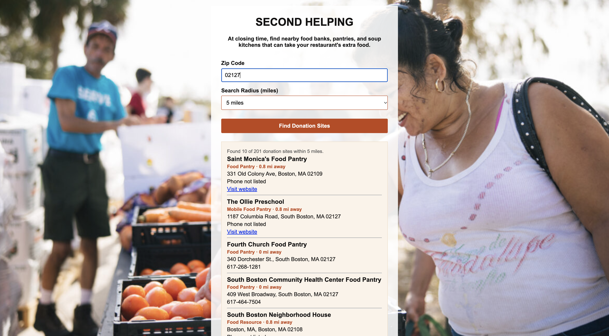

# Second Helping 🍽️

A page that helps a restaurant find nearby food banks, pantries, and soup kitchens that can take its extra food at closing time.

## Description

This is a project I built to practice using an API with user input. A restaurant enters its zip code and picks how far it is willing to go, and the page searches a directory of food donation sites. It shows up to 10 of the closest ones with their name, what kind of site they are, the distance, the address, the phone number, and a link to their website. It uses plain HTML, CSS, and JavaScript with `fetch`, so there is no server to run.

## Screenshot

<!-- Replace the file name below with your own screenshot. Put the picture in the screenshots folder.
     Mac tip: Cmd + Shift + 4, then drag a box around the app. -->

## Features

- Search by zip code
- Choose a search radius: 5, 10, 25, or 50 miles
- Shows the closest donation sites (up to 10) with the distance in miles
- Labels each site as a Food Bank, Food Pantry, Soup Kitchen, Mobile Food Pantry, or Community Fridge
- Shows the address, phone number, and a link to the website when they are listed
- Shows how many sites were found out of how many are available in that radius
- Friendly messages if nothing is found or the directory can't be reached
- Photo background

## Tech Used

- HTML
- CSS
- JavaScript
- `fetch` and promises (`.then()` and `.catch()`)
- Feed America's food resource directory API

## How to Use

This app doesn't need a server or an API key.

1. Download or clone the project.
2. Open `index.html` in your browser (or use the Live Server extension in VS Code).
3. Type your 5-digit zip code.
4. Choose a search radius.
5. Click **Find Donation Sites**.

## How It Works

1. When you submit the form, `main.js` reads the zip code and the radius.
2. It builds a web address with `URLSearchParams` and uses `fetch` to ask the directory for sites near that zip code.
3. It checks the answer for an error. If there is one, it shows a message instead.
4. If there are results, it turns each site into a block of HTML with its name, type, distance, address, phone, and website, and shows the list.
5. If there are no results, it suggests trying a bigger radius.

## What I Learned

- How to send user input to an API with `fetch` and `URLSearchParams`
- How to turn a list of results into HTML with `.map()` and template strings
- How to handle errors and empty results so the page doesn't just break
- How to use a lookup object to turn codes like `food_pantry` into friendly labels
- How to fix a background image so it doesn't repeat

VIEW APP HERE: https://second-helping.onrender.com/

## Author

Maya Rose 🌹
